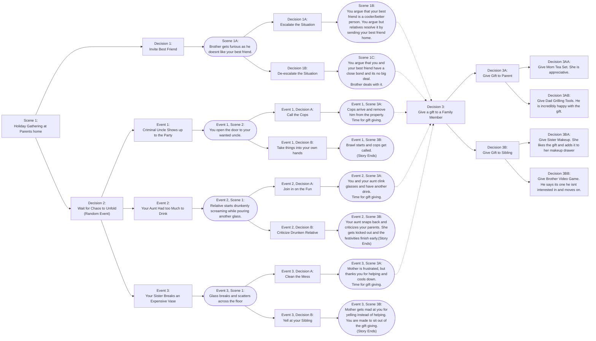

# [Christmas Conundrum]

> WEB-115 Final Project: an interactive, browser-based story built with HTML, CSS and JavaScript.

---

## Team Members and Roles

| Name | GitHub Username | Responsibilities |
|------|-----------------|------------------|
| [Kjai Hamblin] | [@khamwtcc] | [Flowchart, Storywriting, JavaScript] |
| [Parker Mozingo] | [@MrsMozingo] | [HTML, CSS] |
| [Jason Wendel] | [@jaswen2003] | [Flowchart, Storywriting, JavaScript] |

## Application Overview

### Story
[In this story you are a regular person with a hectic family doing your best to navigate a Christmas party that could potentially go wrong in the blink of an eye.]

### Gameplay
[In this story you have to navigate throughout the day by making your own decisions. The goal is to make it to gift giving time without anything going wrong so you can give a family member the perfect gift.]

### Rules and Navigation
- [In this game you have to click on one of two choice buttons provided depending on the situation you are currently in to progress through the day.]
- [Includes some randomized events for different ways the day can go.]

## Story Flowchart

